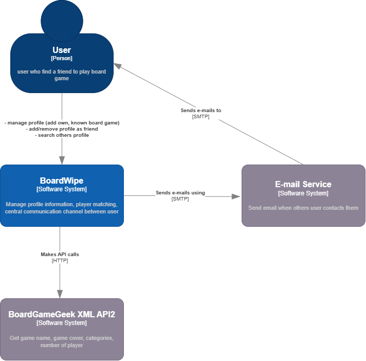
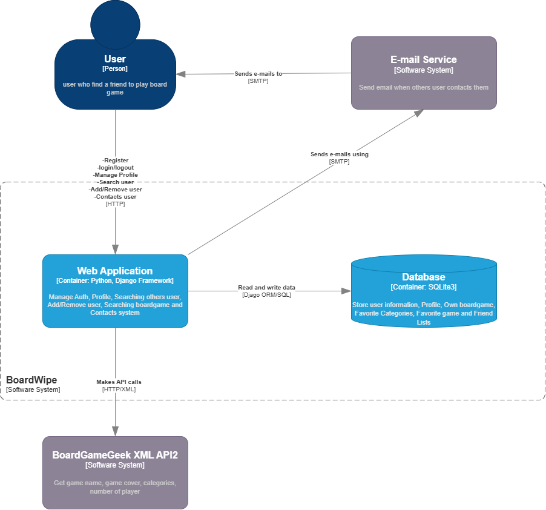
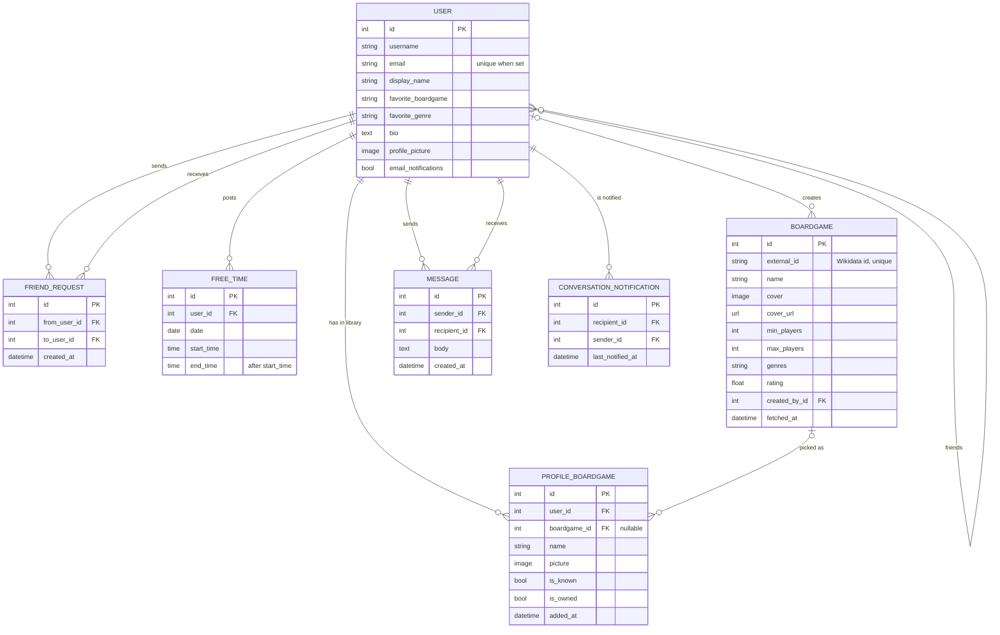

# BoardWipe — Board Game Community (CN331)

[](https://github.com/6710615169/BoardWipe/actions/workflows/ci.yml)

## System Overview

**BoardWipe** is a web application that helps board game players find each other and get a game on the table.

**Purpose**

- **Profiles:** show your favourite genre and game, a bio and a profile picture.
- **Game library:** pick games from a shared catalog (imported from Wikidata) or add your own, and mark each one as *known* (you can play it) or *owned* (you have a copy).
- **Friends:** search for players, send and accept friend requests.
- **Free time:** post when you are free so friends can see when to meet up.
- **Chat:** send direct messages, with optional email notifications for new messages and friend requests.

**Team members**

| Student ID | Name |
|---|---|
| 6710615169 | Phetphong Kanmud |
| 6710615086 | Napat Chumcome |
| 6710545028 | Phudinan Jenjobketr |
| 6710545036 | Purich Amposre |
| 6710615128 | Tortawan Luangaramchai |

**Tech stack:** Python 3.12, Django 5.2, PostgreSQL (production) / SQLite (local), WhiteNoise, Cloudinary (media uploads), Gunicorn, Render, GitHub Actions.

## Live Demo

**Production:** `https://boardwipe.onrender.com/`

> Render's free tier sleeps when idle, so the first request can take about a minute.

## Architecture

### System Context Diagram (C4 Level 1)



### Container Diagram (C4 Level 2)



### Entity Relationship Diagram



### Project layout

```
BoardWipe/
├── build.sh              # Render build: install, collectstatic, migrate
├── Procfile              # Render start: gunicorn config.wsgi
├── requirements.txt
├── doc/                  # architecture diagrams, sprint retrospectives
└── src/                  # Django project (manage.py lives here)
    ├── config/           # settings, root URLs, WSGI/ASGI
    ├── accounts/         # users, profiles, friends, game catalog, free time
    └── chat/             # direct messages and email notifications
```

## Local Setup

Requires Python 3.12 and Git.

```bash
# 1. Clone
git clone https://github.com/6710615169/BoardWipe.git
cd BoardWipe

# 2. Create and activate a virtual environment
python -m venv .venv
source .venv/bin/activate        # macOS / Linux
# .venv\Scripts\activate         # Windows

# 3. Install dependencies
pip install -r requirements.txt

# 4. Configure environment variables (sets DEBUG=True for local work)
cp .env.example .env

# 5. Run migrations (SQLite is used when DATABASE_URL is not set)
cd src
python manage.py migrate

# 6. (Optional) create an admin and fill the game catalog from Wikidata
python manage.py createsuperuser
python manage.py import_games --limit 500

# 7. Start the server -> http://localhost:8000
python manage.py runserver
```

### Environment variables

| Variable | Purpose | Default |
|---|---|---|
| `DEBUG` | Turns debug mode on for local development | `False` |
| `SECRET_KEY` | Django secret key | random key for each run |
| `DATABASE_URL` | PostgreSQL connection string | local SQLite file |
| `ALLOWED_HOSTS` / `CSRF_TRUSTED_ORIGINS` | Comma-separated hosts/origins | `localhost,127.0.0.1` / empty |
| `CLOUDINARY_URL` | Store uploads on Cloudinary | local disk |
| `EMAIL_HOST_USER` / `EMAIL_HOST_PASSWORD` | Gmail account + app password for notifications | emails printed to console |
| `SITE_URL` | Base URL used for links in emails | `http://localhost:8000` |
| `GAME_API_ENABLED` | Set to `0` to disable Wikidata lookups | `1` |

### Deployment (Render)

- **Build command:** `./build.sh` (installs, runs `collectstatic` and `migrate`, and creates an admin from `DJANGO_SUPERUSER_*` if set)
- **Start command:** `gunicorn --chdir src config.wsgi:application`
- Set `DATABASE_URL`, `SECRET_KEY`, `ALLOWED_HOSTS=.onrender.com`, `CSRF_TRUSTED_ORIGINS=https://*.onrender.com` and `CLOUDINARY_URL` in the Render dashboard.

## Test Execution

Run from the `src/` directory:

```bash
cd src
pip install coverage

# Run the test suite with coverage
coverage run --source='.' manage.py test

# Coverage summary (CI fails below 80%)
coverage report -m --fail-under=80

# Optional HTML report -> src/htmlcov/index.html
coverage html
```

### Coverage summary

| Metric | Result |
|---|---|
| Tests | **202 passed**, 0 failed |
| Statement coverage | **97%** (2,382 statements, 69 missed) |
| CI threshold | 80% |

Tests live in `src/accounts/tests/` (accounts, boardgames, catalog, free time, profile hardening) and `src/chat/tests/` (chat, notifications).

### Continuous Integration

Every push and pull request to `main` runs [`.github/workflows/ci.yml`](.github/workflows/ci.yml):

1. **Black**: formatting check
2. **Flake8**: linting
3. **Bandit**: security scan
4. **Tests + coverage**: fails below 80% and uploads the HTML report as an artifact
